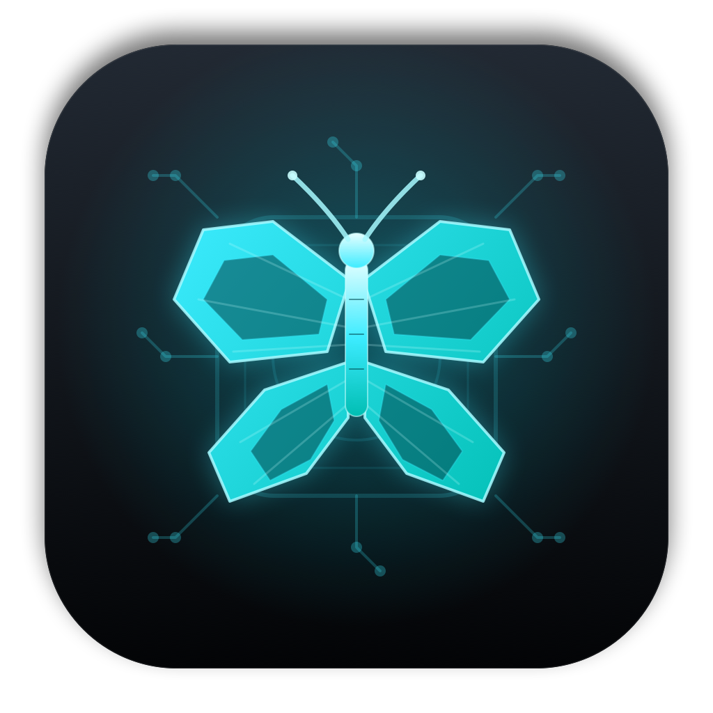

# NullMoth Monitor



[](../../actions/workflows/ci.yml)


A native, read-only macOS menu bar monitor for Hackintosh systems running the
[NullMoth NVIDIA driver](https://github.com/nullmoth/nvidia-macos-driver).

NullMoth Monitor shows what the driver actually exposes: GPU utilization,
temperature, VRAM use, display modes, HDMI/DP audio, kext state, and boot-argument
health. It is a companion, not an installer. It never writes to OpenCore, kexts,
or NVRAM.

> Not affiliated with NullMoth. This project contains no driver code, kexts,
> firmware, or Apple binaries, and is licensed separately under MIT.

**Status:** `0.2.0` — monitor and control panel, universal (`x86_64` + `arm64`),
tested on macOS 26.7.3 with an NVIDIA RTX 3060.

## Features

### Monitor tab

- **Menu bar readout** — live GPU utilization and temperature.
- **GPU panel** — core, memory, encode, and decode utilization; temperature;
  VRAM in use; Metal family; 2-minute utilization sparkline.
- **Displays** — monitor names, pixel resolution, refresh rate, and main display.
- **Audio** — NVIDIA HDMI/DP outputs and the current default output.
- **Driver health** — NVRM/NVAccel/NVRMFB/NVRMAGDC load state and versions,
  Metal plugin version, SIP status, and boot-argument checks.
- **Fans** — RPM when the SMC exposes `FNum`/`F<n>Ac`; gracefully absent otherwise.

### Control panel tab

- **Display control** — switch resolution and refresh rate per display. macOS
  often leaves modes out of System Settings on a Hackintosh; this list comes
  straight from CoreGraphics. It is a session setting, needs no administrator
  rights, and nothing is written to disk.
- **Driver setup doctor** — audits boot arguments and `csr-active-config`
  against the NullMoth documentation and shows a corrected `boot-args` string
  to copy. Read-only: the app never edits OpenCore.
- **Capability report** — Metal family, argument buffers, ray tracing, MPS,
  hardware H.264/HEVC encode and decode, OpenGL through GL-on-Metal, and the GSP
  firmware version.
- **Driver update check** — asks GitHub for the newest NullMoth release and
  compares it with the installed driver. Nothing is downloaded or installed; the
  1401 app does that.

### Everywhere

- **CLI** — human summary, JSON, Markdown report, watch mode, setup doctor,
  display modes, capabilities, and update check.
- **Private by default** — no telemetry; the update check is the only network
  request and only runs when you ask for it. No serial numbers, UUIDs, or
  EDIDs in reports.

## Requirements

- macOS 14 or later (developed and tested on macOS 26.7.3, Intel).
- The NullMoth driver for live GPU data. Without it, the app still reports system,
  display, and audio information.
- Swift 5.9+ and the Xcode command line tools to build.

## Build and run

```sh
make build          # debug/release build of the CLI and app
make test           # unit tests
make app            # bundle "build/NullMoth Monitor.app" for this Mac
make app-universal  # bundle for both Intel and Apple Silicon
make icon           # regenerate the app icon from Scripts/GenerateIcon.swift
open "build/NullMoth Monitor.app"
```

The app is a menu bar accessory (`LSUIElement`), so it has no Dock icon. Click the
status item for the panel, right-click for the monitor, the control panel, a
refresh, a copied report, and quit.

### Install the CLI

```sh
sudo make install PREFIX=/usr/local
```

## CLI

```sh
nullmoth-mon                  # human-readable summary
nullmoth-mon --json           # full snapshot as JSON
nullmoth-mon --report         # redacted Markdown report
nullmoth-mon --watch          # one compact line per second
nullmoth-mon --doctor         # audit the driver setup
nullmoth-mon --modes          # list the display modes macOS offers
nullmoth-mon --capabilities   # report what the driver supports
nullmoth-mon --check-update   # ask GitHub for the latest driver release
nullmoth-mon --help
```

`--json` is safe to pipe: the driver writes its own log lines to stderr, so stdout
stays valid JSON. `--check-update` is the only command that touches the network,
and only when you run it.

Example:

```
NullMoth Monitor
  GPU:          NVIDIA GeForce RTX 3060
  Driver:       3.0
  Metal:        Metal 4
  Utilization:  8% core, 2% memory, 0% encode, 0% decode
  Temperature:  51°C
  VRAM:         445.4 MB used / 12 GB
  Displays:     2
    1. MSI MP223 — 1920x1080 @ 100 Hz (main)
    2. LCD-MONITOR — 1366x768 @ 60 Hz
  Audio:        4 NVIDIA HDMI/DP output(s); default: USB PnP Audio Device
  Kexts:        4/4 loaded
  Plugin:       installed 0.1
  SIP:          Custom Configuration
  Boot args:    OK
  Fans:         not exposed by the SMC
```

## Data sources

| Data | Source |
|---|---|
| Core / memory / encode / decode utilization, temperature | `NVAccel` → `PerformanceStatistics` |
| VRAM in use, GART window | `NVAccel` → `PerformanceStatisticsAccum` |
| Driver version, BARs | `NVRM` registry properties |
| GPU name, Metal family, ray tracing | Metal (`MTLCopyAllDevices`) |
| VRAM total | `system_profiler SPDisplaysDataType -json` |
| Displays | CoreGraphics + `NSScreen.localizedName` |
| Display modes | CoreGraphics (`CGDisplayCopyAllDisplayModes`) |
| Audio devices | CoreAudio |
| Kexts | `kmutil showloaded` |
| SIP | `csrutil status` |
| Boot arguments | `nvram boot-args` |
| SIP configuration value | `nvram -X csr-active-config` |
| Hardware video codecs | VideoToolbox (`VTIsHardwareDecodeSupported`, encoder list) |
| OpenGL renderer | CGL (`CGLChoosePixelFormat`) |
| GSP firmware version | `/Library/NullMoth/nvfw/nvidia` |
| Driver releases | GitHub releases API, only on request |
| Fans | `AppleSMC` (`FNum`, `F<n>Ac`) |

All probes are read-only, except applying a display mode the user picked. Expensive
probes (kexts, SIP, boot args, VRAM total) are cached for 30–60 seconds; GPU and
display probes run every refresh.

## Notes and limitations

- Fan RPM depends entirely on what the SMC exposes. Many desktop boards expose no
  fan keys through `AppleSMC`, so the Fans section may legitimately be empty.
- The driver reports GPU utilization as integer percentages. Sub-second spikes are
  smoothed by the 1 Hz sampling rate.
- The Metal device name is decorated by the translator (for example
  `NVMTL over NVIDIA GeForce RTX 3060 (NVK GA106-A)`); the app displays the clean
  card name.
- macOS 27 drops Intel support, so this tool targets macOS 14–26.
- The driver has no user-facing settings surface, so there is no Windows-style
  power profile, per-application GPU preference, or overclocking control to
  offer. The driver's configuration lives in OpenCore (`boot-args`,
  `csr-active-config`, `SecureBootModel`), and the doctor audits those instead
  of writing them.

## Project layout

```
Sources/NullMothCore/          probes, models, and report generation
Sources/NullMothOpenGL/        small C shim for the deprecated OpenGL API
Sources/NullMothMonitorCLI/    nullmoth-mon
Sources/NullMothMonitorApp/    menu bar app (AppKit + SwiftUI)
Tests/NullMothCoreTests/       parser and report tests
Scripts/GenerateIcon.swift     deterministic icon renderer
Scripts/make-icon.sh           PNG → .icns
Scripts/bundle.sh              app bundle builder
Support/Info.plist             app bundle metadata
Support/AppIcon.png            icon source (1024×1024)
Support/AppIcon.icns           bundled icon
docs/                          handoff, publishing, changelog, docs index
.github/workflows/             CI and tag-release workflows
```

## Documentation

- [Documentation index](docs/README.md) — all guides in one place.
- [Handoff notes](docs/HANDOFF.md) — project state, hardware validation, roadmap.
- [Publishing](docs/PUBLISHING.md) — GitHub setup, CI, and release steps.
- [Changelog](docs/CHANGELOG.md) — release history.
- [Agent guide](AGENTS.md) — instructions for AI coding agents.
- [Contributing](CONTRIBUTING.md) — setup, tests, and pull-request checklist.
- [Security policy](SECURITY.md) — reporting and design guarantees.

## License

MIT. See [LICENSE](LICENSE).

The NullMoth driver, its kexts, and its Metal plugin remain under their own
licenses (PolyForm Noncommercial 1.0.0 and others). This project does not include
or redistribute any of them.
